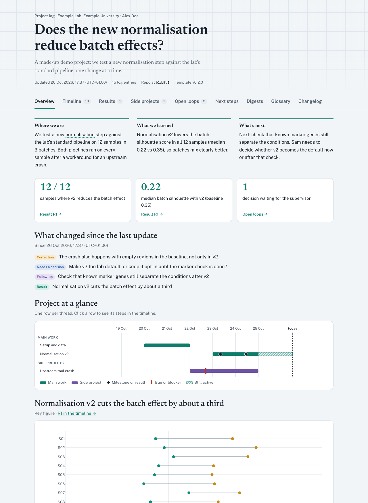

# project-log

A [Claude Code](https://claude.com/claude-code) skill that keeps a research project's story while you work, and turns it into one readable, interactive HTML page.

It logs progress, results, bugs that were fixed, detours, decisions, corrections, open follow-ups, side projects, papers and jargon. Every result carries its "so what", the script, the commit and the data version. The page has a timeline, a Gantt chart, interactive figures, open loops, a glossary and a changelog. The top is a two-minute read for a supervisor, and the detail sits underneath.



*The demo project is made up. Build it yourself with `examples/demo/make_demo.sh`.*

## Why

When most of the work happens through an AI agent, it's easy to lose track of what was tried, what broke and was fixed, and what was left for later. Progress notes help, but they are hard to scan, hard to trust and hard to show to anyone else. This skill makes Claude write a structured, append-only log as it works, and builds a page you can send to your supervisor.

## Requirements

- Claude Code
- git, and Python 3.9 or newer (logging uses only the standard library, so it also works on a cluster)
- [uv](https://docs.astral.sh/uv/) to build the page and make figures (it fetches PyYAML and Plotly by itself)
- Google Chrome, only for exporting figures as static SVG for slides

## Install

```bash
git clone <this repo> ~/Projects/project-log-skill
~/Projects/project-log-skill/install.sh        # copies the skill to ~/.claude/skills/project-log
```

Run `install.sh` again after pulling updates. On a cluster, copy `~/.claude/skills/project-log/` across, e.g. with `rsync`.

## Use it in a project

Open Claude Code in your project folder and say:

| When | Say |
|---|---|
| Once, at the start | **"Set up the project log"**: Claude asks three questions (audience, tabs, figure conventions) and sets things up. If the repo already has history, it offers to import it as a draft for you to review first. |
| While you work | Nothing. Claude logs bugs, results, decisions, detours and follow-ups as they happen. If it misses something: "log that". |
| A result with numbers | Claude proposes a chart; say yes or adjust it. |
| End of a session | **"Let's wrap up"**: Claude lists what was logged and what is still open, asks what to add, and writes a session summary. |
| To see the page | **"Update the project log"**: refreshes the overview, builds `project-log/report/project-log.html` and tells you what changed. |
| To share it | **"Publish the project log"**: needs the Artifact tool; otherwise send the HTML file. |
| After working elsewhere without the skill | **"Catch the project log up since <date>"** |

Setup adds a short "Project log" section to your `CLAUDE.md`, and a hook in `.claude/settings.json`. After Claude edits your progress notes (e.g. `PROGRESS.md`), the hook reminds it to log the same facts. Commit both, and trust the folder when Claude Code asks, so that the hook runs.

## What's in your repo afterwards

```
project-log/
  project.yaml        title, threads (main work and side projects), overview text, settings
  entries/            one small Markdown file per entry, append-only
  figures/scripts/    the scripts that make each figure (rerunnable)
  figures/out/        interactive Plotly JSON and static SVG
  report/             the built page and its build history
```

## Guarantees

- **Append-only.** A published entry is never edited. Mistakes get a correction entry, which the page shows as a "Corrected later" banner. The build refuses to run if a published entry or figure has changed.
- **Provenance captured, not typed.** Commit, uncommitted-changes flag, scripts and data hashes are recorded automatically.
- **Nothing reaches the page unchecked.** Broken links, results without a "so what", glossary terms without a definition, unreviewed imports and copies made by sync tools (iCloud, Dropbox) all stop the build.
- **Recoverable.** Every page embeds all entries, so a lost log can be rebuilt from any page.

## Privacy

The page embeds the full log. Treat it like your lab notebook, and share it only with people who may see your unpublished work. Keep repositories out of synced folders (iCloud Desktop & Documents, Dropbox), which create duplicate files.

## Develop

`tests/smoke.sh` builds the demo and checks the guarantees above. The skill itself is in `skills/project-log/`; `SKILL.md` is the entry point.

## License

MIT, see [LICENSE](LICENSE).
