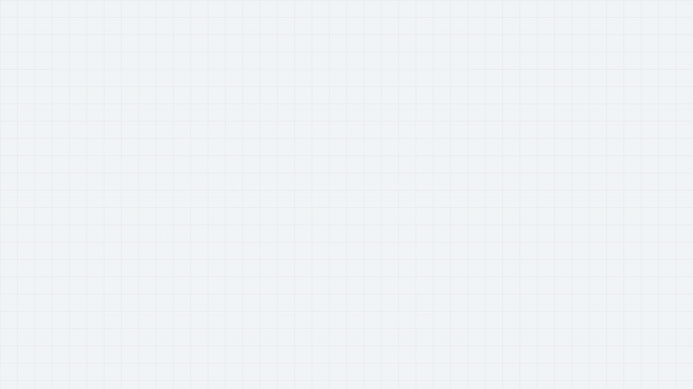

<div align="center">

# project-log

**A lab notebook that writes itself while Claude Code does your research.**

Claude logs results, bugs, detours and decisions as they happen, and builds one interactive page your supervisor can read in two minutes.

[](https://claude.com/claude-code)
[](CHANGELOG.md)
[](#requirements)
[](LICENSE)

[**Live demo**](https://claude.ai/artifact/Bfw53U8hSVwVEtTxFsraP8) · [Install](#install) · [How to use it](#use-it) · [What you get](#what-you-get)



<sub>The demo is a real isoform-switch analysis of the example data in IsoformSwitchAnalyzeR; the people and a few mishaps are made up. Rebuild it with <code>examples/demo/make_demo.sh</code>.</sub>

</div>

## Why

When an AI agent does half the work, the project's story gets lost fast:

| The problem | What project-log does |
|---|---|
| *"What did we try last month, and why did we drop it?"* | Every bug, detour and decision becomes a short entry **as it happens**, with the reason. |
| *"Which commit and data made this figure?"* | Commit, uncommitted changes, scripts and data checksums are **captured automatically**. |
| *"Is this number still right?"* | The log is **append-only**. Mistakes get a correction entry, and the old claim shows a *Corrected later* banner. |
| *"Can you send me an update?"* | One command builds a page with a **two-minute summary on top** and full detail underneath. |
| *"What's still open?"* | Follow-ups, blockers and questions stay in **Open loops** until something closes them. |

## Features

- **Overview for your supervisor:** where you are, what you learned and what's next, 3–4 key numbers, and decisions waiting on them.
- **Gantt chart** of the main work and side projects, with milestones, bugs and what's still running.
- **Figures** with every result: interactive Plotly charts, or your tools' own plots (R, ggplot) as images. Each is made by a rerunnable script, and Claude asks before making one.
- **Timeline** of every entry, filterable by thread and type, with tables, links and provenance.
- **Glossary** with hover definitions, so non-specialists can follow along.
- **Paper digests:** what each paper found and why it matters here.
- **Safety checks:** the build refuses edited entries, changed figures, broken links, results without a "so what", and duplicate files made by iCloud or Dropbox.
- **Recoverable:** every page embeds the whole log, so a lost log can be rebuilt from any copy.

## Install

In Claude Code:

```text
/plugin marketplace add chunxubioinfor/project-log-skill
/plugin install project-log@project-log-skill
```

That's it. If the skill doesn't show up straight away, restart Claude Code.

<details>
<summary>Manual install (no plugin system, or on a cluster)</summary>

```bash
git clone https://github.com/chunxubioinfor/project-log-skill ~/Projects/project-log-skill
~/Projects/project-log-skill/install.sh     # copies the skill to ~/.claude/skills/project-log
```

Run `install.sh` again after `git pull`. Don't clone into `~/.claude/skills/` itself; `install.sh` refuses to run from there. On a cluster, copy `~/.claude/skills/project-log/` across, e.g. with `rsync`.
</details>

### Requirements

- Claude Code, git, and Python 3.9+. Logging uses only the standard library, so it works on any machine.
- [uv](https://docs.astral.sh/uv/) to build the page and make figures (it fetches PyYAML and Plotly itself).
- Optional: Google Chrome, to also export each figure as SVG for slides.

## Use it

Open Claude Code in your project folder and just talk:

| When | Say |
|---|---|
| Once, at the start | **"Set up the project log"**. Claude reads your repo, then asks four quick questions (audience, tabs, figure style, charts online or offline). If there's history, it offers to import it as a draft for you to review. |
| While you work | Nothing. Claude logs as it goes. If it misses something: *"log that"*. |
| A result with numbers | Claude proposes a chart in one sentence. Say yes, or adjust it. |
| End of a session | **"Let's wrap up"**. Claude lists what was logged and what's still open, asks what to add, and writes a session summary. |
| To see the page | **"Update the project log"**. Builds `project-log/report/project-log.html` and tells you what changed. |
| To share it | **"Publish the project log"**. Gives a private link (needs the Artifact tool); or send the HTML file. |
| After working without it | **"Catch the project log up since 3 Nov"** |

## What you get

```text
project-log/
  project.yaml        title, threads (main work, side projects), overview, settings
  entries/            one small Markdown file per entry, append-only
  figures/scripts/    the script behind every figure (rerunnable)
  figures/out/        interactive Plotly JSON, plus SVG for slides
  report/             the built page (about 0.3 MB) and its build history
```

The page it builds from that log:


Setup also adds a short "Project log" section to your `CLAUDE.md`. When you edit your progress notes (e.g. `PROGRESS.md`), a small hook reminds Claude to log the same facts. Commit `project-log/` like any other code.

## Privacy

The page contains your whole log. Treat it like your lab notebook, and share it only with people who may see unpublished work. Shared links are private until you choose to share them. Keep git repositories out of synced folders (iCloud Desktop & Documents, Dropbox), which create duplicate files.

## Develop

`tests/smoke.sh` builds the demo from scratch and checks every guarantee above (needs `uv`). The skill lives in `skills/project-log/`, and `SKILL.md` is the entry point. Issues and pull requests are welcome. This is an early release, tested on one real research project so far.

## License

MIT, see [LICENSE](LICENSE).
